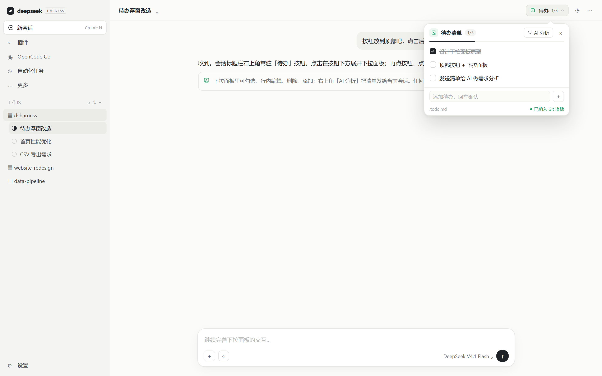

# dsh-todo-list

A per-project todo checklist for [DeepSeek Harness](https://github.com/deepseek-ai/dsh), opened from the session header as a compact dropdown and stored as a real file in the project root.

[中文](README.zh.md)



Complex requests have many steps. This plugin keeps them in one place the team and the AI can both read:

- a **Todo** button in the session header, in every session, existing or new; clicking it opens a small dropdown under the button;
- create tasks, check them off (done tasks turn grey with a strikethrough), edit and delete them;
- the list lives in `.todo.md` at the project root and, inside a Git work tree, is added to Git tracking so progress travels with every commit;
- a light entry on the blank new-session screen opens the same panel;
- one click sends the list to the current AI session, which analyses the unfinished tasks against the completed ones for reasonableness, conflicts and ordering.

## Features

- **Header trigger + dropdown.** Registers a compact button in the session header's utility band (`conversation.session.header.utilities`). Its dropdown is portaled to the document body and positioned from the button, so the header never clips it. A hero hint on a blank new session opens the same panel.
- **Task operations.** Add from the bottom input (Enter), toggle with the checkbox, click the text to edit inline (Enter/blur saves, Esc cancels), delete from the row's hover control. Saves are optimistic and serialized; a failure is reported with a retry path.
- **File is the source of truth.** Every save rewrites only the Markdown checklist lines and preserves headings, comments and notes. An edit made by the AI, a collaborator, or the user's editor is picked up within a few seconds while the panel is open; the panel reloads the file and says so.
- **Git tracking.** In a Git work tree, the first save runs `git add -- .todo.md` (it never commits). An ignored file is reported instead of silently left behind; a non-Git project shows a neutral badge.
- **New-session hint.** On a blank session the Hero row shows a small dashed chip: “Complex task? Track it” (or the current progress). Clicking it opens the dropdown.
- **Send to AI.** The panel header button reads the file fresh, builds a structured analysis prompt (all tasks, counts, what to check), and delivers it to the current session as one user-visible follow-up message. This is the only message the plugin ever adds to a session log.

## Install

Install the package directory as a bundle into the DSH profile — **Settings → Plugins → Add plugin** and pick this directory — or use the `dsh` plugin tooling. Enable the `dsh-todo-list` row if it is not enabled yet, then reload the Web GUI.

## Use

1. Open any session (existing ones included) and click **Todo** in the session header, next to the history and More controls. The button shows the project's progress, such as `1/3`.
2. Add tasks in the input at the bottom of the dropdown.
3. Check tasks off as you finish them — completed tasks turn grey with a line through them.
4. Click **AI analysis** to have the current AI session analyse the unfinished tasks against the completed ones (conflicts, duplication, dependency order, whether they are still reasonable).
5. Commit the project as usual: `.todo.md` is already in the Git index, so it goes out with the next commit. Collaborators see the checklist in the repository.
6. Close the dropdown by clicking the button again, clicking outside it, pressing Esc, or using its `×` control.

On a blank new session the dashed **Complex task? Track it** chip does the same thing.

## File format

The default file is `.todo.md` in the session working directory:

```markdown
<!-- dsh-todo: this file is managed by the DSH todo list plugin; tasks are the checklist lines and other content is preserved. -->

# Todo list

- [ ] 未完成的事项
- [x] 已完成的事项
```

Every `- [ ]` / `- [x]` line in the file is a task, wherever it appears; other lines are kept untouched. To avoid clobbering an unrelated file, the plugin refuses to write a same-name file that has neither task lines nor its marker.

## Configuration

The Loader row config can be overridden in the profile's `cordis.patch.yml`:

| Key | Default | Meaning |
| --- | --- | --- |
| `fileName` | `.todo.md` | Todo file relative to the session working directory. Must stay inside it. |
| `gitTrack` | `true` | Run `git add` for the file when the project is a Git work tree (never commits). |
| `hintOnNewSession` | `true` | Show the light entry on a blank new session. |
| `maxItems` | `200` | Maximum tasks one save may write. |
| `maxItemLength` | `500` | Maximum characters kept per task. |
| `sendPromptTemplate` | `''` | Optional override for the analysis prompt; supports `{file}`, `{path}`, `{total}`, `{done}`, `{open}`, `{list}`, `{completed}`. |
| `gitTimeoutMs` | `20000` | Timeout for one Git invocation. |

## What changes in a session

- Checking tasks, editing, deleting and reading never append session events.
- **Send to AI** adds exactly one user message with the checklist and the analysis request, so a fork or resume reproduces the analysis from the log alone.

## Limitations

- The file is the only source of truth; a task line that a user manually rewrites into prose stops being a task.
- Concurrent edits are last-write-wins: the panel detects external changes and reloads, but does not merge two divergent edits.
- The plugin stages the todo file but never commits; commit messages and timing stay with the user.
- The dropdown is anchored to the header button and repositions on resize; on very narrow windows it shrinks to the viewport width.

## Development

Plain JavaScript, no build step:

```text
index.js            Host half: file model, Git tracking, load/save/send routes
client.js           Client half: header trigger, dropdown panel, new-session hint, copy, styles
cordis.patch.yml    Loader row
locale/en.json      Plugin Manager display text (English)
locale/zh.json      Plugin Manager display text (Chinese)
docs/REQUIREMENTS.md  Requirement analysis and design decisions
prototype/          Header-button + dropdown design mock and captured states
test/               node:test suites for both halves
```

Run `npm test` (or `node --test`) to execute the suites. The Host test mounts the real routes on a fake Cordis context and uses throwaway Git repositories; the Client test loads the browser artifact with a fake module loader and context.

## License

[MIT](LICENSE)
