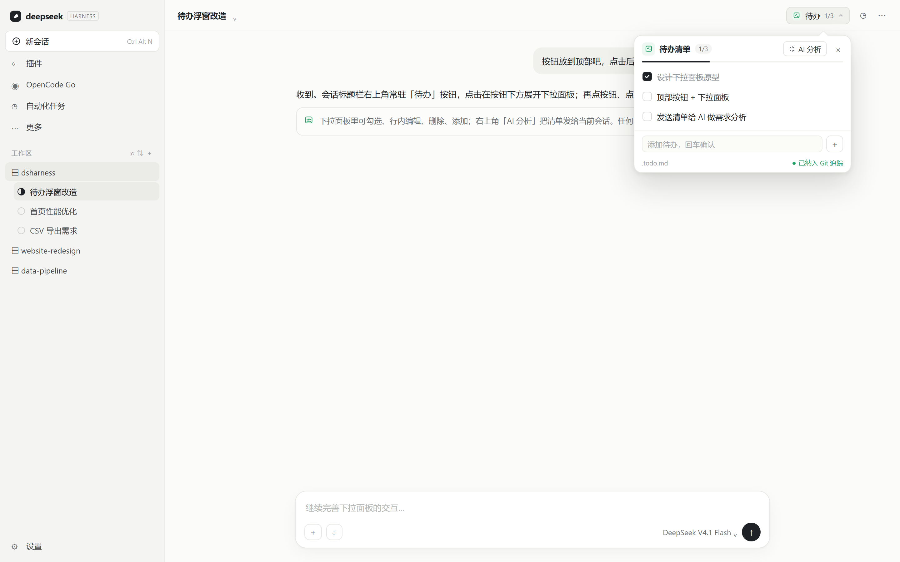

# dsh-todo-list

为 [DeepSeek Harness](https://github.com/deepseek-ai/dsh) 提供一份**项目级待办清单**：从会话标题栏一键展开下拉面板，并真实保存在项目根目录。

[English](README.md)



复杂需求有很多步骤。这个插件把步骤集中在一个地方，人和 AI 都能读到：

- 标题栏常驻 **待办** 按钮，已创建会话、新会话都有；点击在按钮下方展开下拉面板；
- 新建、勾选完成（完成后置灰并加删除线）、修改、删除待办；
- 清单保存在项目根目录的 `.todo.md`，在 Git 工作树内会自动纳入追踪，执行进度随每次提交共享给协作者；
- 新建空白会话时的 Hero 轻提示也会打开同一个面板；
- 一键把清单发给当前 AI 会话，重点分析未完成项，并结合已完成项判断是否合理、是否冲突、建议的执行顺序。

## 功能

- **标题栏按钮 + 下拉面板。** 在会话标题栏右侧工具区（`conversation.session.header.utilities`）注册紧凑按钮；面板 portal 到 `document.body` 并按按钮位置定位，标题栏不会裁剪。空白新会话的 Hero 提示打开同一个面板。
- **待办操作。** 底部输入框回车新增；复选框勾选完成；点击文字行内编辑（回车/失焦保存，Esc 取消）；悬停行尾删除。保存为乐观更新 + 串行写队列，失败会提示并可重试。
- **文件即事实来源。** 每次保存只重写 Markdown 任务行，保留标题、注释与说明文字。面板打开期间，AI、协作者或用户自己编辑文件后会在几秒内自动重载并提示。
- **Git 追踪。** 在 Git 工作树内，首次保存会执行 `git add -- .todo.md`（绝不自动 commit）。被 `.gitignore` 忽略时明确告警；非 Git 项目显示中性徽标。
- **新会话轻提示。** 空白会话的 Hero 行出现虚线小胶囊「复杂需求？建个待办清单」（已有待办时显示进度），点击打开下拉面板。
- **发送给 AI。** 面板头部「AI 分析」重新读取文件，组装结构化分析提示词，作为**一条用户可见的跟进消息**发给当前会话。这是插件唯一会写入会话日志的内容。

## 安装

把包目录作为 bundle 安装到 DSH profile（**设置 → 插件 → 添加插件** 选择本地目录，或使用 `dsh` 插件工具），必要时启用 `dsh-todo-list` 行，然后刷新 Web GUI。

## 使用

1. 打开任意会话（已创建的也可以），点击标题栏右上角、历史/更多按钮左侧的 **待办** 按钮；按钮上显示项目进度，例如 `1/3`。
2. 在下拉面板底部的输入框添加待办。
3. 完成后勾选：已完成的待办置灰并加删除线。
4. 点击「AI 分析」，让当前 AI 会话分析未完成待办：是否仍然合理、与已完成实现是否冲突/重复、依赖顺序是否需要调整。
5. 照常提交代码：`.todo.md` 已在 Git 暂存区，会随下一次提交进入仓库，协作者能看到清单。
6. 再次点击按钮、点击面板外、按 Esc、或点面板右上角 `×` 都可以收起。

空白新会话上，虚线胶囊「复杂需求？建个待办清单」同样可以打开面板。

## 文件格式

默认文件为会话工作目录下的 `.todo.md`：

```markdown
<!-- dsh-todo: this file is managed by the DSH todo list plugin; tasks are the checklist lines and other content is preserved. -->

# Todo list

- [ ] 未完成的事项
- [x] 已完成的事项
```

文件中任意位置的 `- [ ]` / `- [x]` 行都会被识别为待办，其余内容原样保留。为避免误吞用户文件：同名文件既没有任务行、也没有插件标记时，插件拒绝写入。

## 配置

可以在 profile 的 `cordis.patch.yml` 里覆盖 Loader 行配置：

| 键 | 默认值 | 含义 |
| --- | --- | --- |
| `fileName` | `.todo.md` | 相对会话工作目录的待办文件，必须位于工作目录内。 |
| `gitTrack` | `true` | Git 工作树内是否自动 `git add`（不会 commit）。 |
| `hintOnNewSession` | `true` | 空白新会话是否显示轻提示。 |
| `maxItems` | `200` | 单次保存最多写入的待办条数。 |
| `maxItemLength` | `500` | 单条待办最多保留的字符数。 |
| `sendPromptTemplate` | `''` | 可选的发送提示词模板，支持 `{file}`、`{path}`、`{total}`、`{done}`、`{open}`、`{list}`、`{completed}`。 |
| `gitTimeoutMs` | `20000` | 单次 Git 命令超时。 |

## 对会话的影响

- 勾选、编辑、删除、读取都不会写入会话事件。
- **发送给 AI** 只增加一条用户消息（包含清单与分析要求），因此 fork / resume 之后仍能从会话日志复现这次分析。

## 限制

- 文件是唯一事实来源：用户手动把任务行改成普通文字后，它就不再是待办。
- 并发编辑按「后写者覆盖」处理：面板会发现外部修改并重载，但不做三方合并。
- 插件只把文件加入 Git 暂存区，不自动提交；提交信息与时机由用户决定。
- 下拉面板锚定在标题栏按钮下方并随窗口缩放重定位；窗口很窄时宽度收缩到视口内。

## 开发

纯 JavaScript，无构建步骤：

```text
index.js            Host 半边：文件模型、Git 追踪、load/save/send 路由
client.js           Client 半边：标题栏按钮、下拉面板、新会话提示、文案与样式
cordis.patch.yml    Loader 行
locale/en.json      插件管理器展示信息（英文）
locale/zh.json      插件管理器展示信息（中文）
docs/REQUIREMENTS.md  需求分析与设计决策
prototype/          顶部按钮 + 下拉面板原型与截图
test/               两半的 node:test 测试
```

执行 `npm test`（或 `node --test`）：Host 测试会在假的 Cordis 上下文上挂载真实路由，并用临时 Git 仓库验证追踪行为；Client 测试用假的模块加载器与上下文加载真实浏览器产物，检查注册与文案。

## 协议

[MIT](LICENSE)
